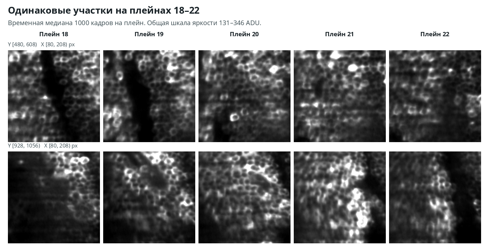

# План объёмного генератора синтетики Plane20

Одна синтетическая сцена описывает участок ткани и все сомы в нём в непрерывных координатах. Сцену можно «снять» несколько раз с разным числом плейнов и разным шагом по Z. Если два сканирования проходят через одну физическую точку, у них там та же клетка, та же геометрия и, при одинаковой оптике, тот же сигнал до шума.

Первый результат — **статический стек в стиле медианы Plane20**, по умолчанию 31 плейн с шагом 10 мкм, с полной маской и постоянным ID каждой сомы. Такой стек можно сравнить с медианой по времени на каждой глубине реальной записи. Кальциевую динамику и обучение объёмного сегментатора можно добавить после проверки пространственной модели.

## На что опираться в репозитории

- В `training/plane20/generate_median.py` функция `generate_pair` уже разделяет геометрию и два варианта освещения. За основу первого объёмного рендера взять её базовый вариант. Функция `shell_patch` задаёт профиль свечения в нормированном радиусе. Угловую модуляцию и амплитуду сэмплируют один раз на сому. [Генератор медиан](../training/plane20/generate_median.py) · [Модель оболочки](../simcalc_zebrafish_pipeline/soma_shell_model.py)
- Контуры на медиане обведены по внешнему видимому краю сомы, на одиночном кадре — примерно по середине оболочки. Для первой версии использовать конвенцию медианы. Пик света и граница полной маски задаются разными параметрами. [Описание разметки и режимов](вводная_синтетика.md)
- В `data/` лежат пять файлов `Plane_Aligned_18.tiff` … `Plane_Aligned_22.tiff`. В каждом проверены все 1000 временных страниц, каждая размером 1376 × 320 (YX), `uint16`. Номера плейнов последовательны. В TIFF отсутствуют теги с физическим размером пикселя и глубиной. Подготовленные массивы из `outputs/`, которые читает экспортёр профиля Plane20, в checkout отсутствуют. Первую сквозную проверку можно выполнить на процедурном объёме, а первый профиль реальной ткани построить непосредственно из этих пяти файлов. [Входы экспортёра](../training/plane20/generate.py)

## Что задаёт пользователь

По параметрам съёмки, переданным пользователем, исходное поле имеет **X = 1728 px, Y = 288 px**, размер пикселя **0,576 × 0,576 мкм**, шаг по Z **10 мкм**. Номинальный стек в порядке ZYX имеет форму `(31, 288, 1728)`. Поле XY по границам пикселей занимает 995,328 × 165,888 мкм. Между центрами первого и последнего плейнов 300 мкм.

У загруженных `Plane_Aligned_18…22.tiff` ширина X = 320 px, высота Y = 1376 px. Простая перестановка осей не объясняет оба размера. Для сравнения с разметкой рендерить на сетке TIFF `(5, 1376, 320)` и хранить координаты полигонов в её пикселях. Для процедурной сцены использовать указанный пользователем размер пикселя. Для перевода измерений с TIFF в мкм записать происхождение масштаба экспорта. При обрезке, повороте на 90° и добавлении полей масштаб 0,576 мкм/px сохраняется. Если при экспорте меняли размер изображения, учесть фактическое изменение масштаба по каждой оси. [Описание размеров в репозитории](../README.md)

| Параметр | Договорённость |
|---|---|
| `n_planes` | Целое число ≥ 1, по умолчанию 31. Даже при одном плейне ось Z сохраняется в выходном массиве. |
| `z_step_um` | Положительное расстояние в мкм между центрами соседних плейнов. По умолчанию 10 для этой записи, можно переопределить независимо от числа плейнов. |
| `z_start_um` | Глубина первого плейна в системе координат сцены. Центр плейна с индексом `k` лежит на `z_start_um + k * z_step_um`. |
| Размер пикселя XY | `dy_um`, `dx_um` задаются в профиле. Порядок осей массивов — Z, Y, X. Координаты центров сом хранятся в мкм и могут лежать между плейнами. |
| Профиль и seed | Профиль задаёт физические границы сцены, ткань, плотность, морфологию, оптику и фон. Seed воспроизводит конкретную реализацию этой сцены. |

При общем начале **31 плейн через 10 мкм** и **61 плейн через 5 мкм** охватывают одни и те же 300 мкм. Все глубины первого сканирования совпадают с каждым вторым плейном второго. Профиль должен покрывать запрошенную глубину, а генератор — явно сообщать, если сетка выходит за его границы.

## Как собрать эталон из реальных плейнов

1. Составить таблицу файлов одной записи. Для каждого сохранить путь, числовой номер плейна, глубину из метаданных при наличии, размер YX, число временных кадров и тип пикселя. Проверить пропуски и повторяющиеся номера. Например, при общем шаге съёмки плейны 19 и 21 разделены двумя шагами. Привязку номеров к направлению и масштабу Z взять из параметров съёмки.
2. Для уже выровненных фильмов вычислить одну медиану по времени на плейн, обрабатывая по одному файлу или по полосам Y. Если медианы уже подготовлены, использовать их напрямую. Сохранить интенсивность в исходной шкале. Для визуального сравнения выбрать одну шкалу яркости на весь фрагмент. Проверить совпадение положения ткани по крупным ориентирам и записать обнаруженное межплейновое смещение.
3. На первом непрерывном фрагменте выбрать кроп с несколькими хорошо различимыми сомами и второй кроп для проверки. В обоих просмотреть XY по глубине и сечение XZ через центр выбранной сомы. При известных единицах подписать расстояния в мкм, иначе указать номера плейнов и пиксели XY. Неполная запись позволяет проверить локальную геометрию и видимость клеток в пределах доступных глубин. Полный объём нужен для оценки изменения анатомии по всей глубине.

### Первые измерения на плейнах 18–22

Для локального сравнения принять центр плейна 18 за начало и направить относительную ось Z по возрастанию номера файла. Тогда плейнам 18–22 соответствуют глубины **0, 10, 20, 30, 40 мкм**. Если полный размер сомы вдоль Z меньше 10 мкм, её геометрическая маска может попасть максимум в один плейн этой записи. При этом оптическое размытие способно дать сигнал соседнему плейну. Высоту сомы и ширину осевой PSF следует оценивать с учётом такой редкой выборки.

Для двух кропов 128 × 128 вычислена точная медиана по всем 1000 кадрам каждого плейна, в исходных координатах TIFF. Один участок пересекает тёмную границу ткани, второй захватывает группу ярких сом. На рисунке везде одна шкала 131–346 ADU, границы которой соответствуют общим P2 и P99 десяти изображений.



Крупные структуры и отдельные сомы стоит проверять на разных пространственных масштабах. После вычитания гауссово-сглаженного изображения (σ = 4 px) корреляция Пирсона на одинаковых XY соседних плейнов в двух кропах лежит в диапазоне от −0,026 до 0,114 (восемь сравнений). Привязка клеток между плейнами требует отдельной проверки.

Для предварительной оценки положения ткани взяты медианы по 33 равномерно распределённым во времени кадрам каждого плейна. На разности сглаживаний с σ = 10 и 50 px выполнен поиск XY-сдвига, максимизирующего нормированную корреляцию центральной области 1120 × 192 px. Для четырёх пар соседей максимум смещён на +2…+8 px по Y и −11…−8 px по X в следующем по номеру плейне относительно предыдущего. Это наблюдаемое смещение похожих крупных структур. Его могут давать как регистрация, так и форма ткани на разной глубине.

**Первое задание на реальных данных.** Сверить несколько крупных ориентиров на медианах 18–22, затем вручную отметить примеры уверенных соответствий сом и случаи, где соответствие неоднозначно. Оценивать число плейнов на клетку с учётом того, что трек может обрываться краем пятислойного фрагмента. Долю сом, видимых только в одном плейне, сохранить как самостоятельную характеристику. Диапазон 18–22 использовать для локальной калибровки. Для демонстрации произвольного числа плейнов использовать процедурную сцену, для сравнения анатомии на 31 реальной глубине потребуется соответствующий реальный охват.

## Этапы реализации для Sol

1. **Выделить сцену и схему съёмки.** Добавить объёмный модуль в `simcalc_zebrafish_pipeline/` и отдельную точку запуска по образцу `training/plane20/generate.py`. Развести операции `sample_scene(profile, seed)` и `render_stack(scene, acquisition)`. Сцене принадлежат ткань, объёмные поля и каталог сом. Съёмке принадлежат глубины плейнов и параметры наблюдения. Документировать приоритет явных параметров над настройками профиля. Существующие 2D-команды и форматы должны проходить свои тесты.

2. **Разместить сомы в ткани.** Для прототипа использовать процедурную область ткани с плавно меняющимся по Z контуром и объёмную карту плотности. Сэмплировать центры в разрешённом физическом объёме, учитывать близость соседей в мкм по трём осям. Плотность задавать в клетках на единицу объёма. Число клеток в одном 2D-срезе использовать для проверки результата. Задать ткань с запасом на краях сканирования, чтобы в первый и последний плейн попадали сечения и свет от сом с центром за пределами запрошенного интервала.

3. **Построить геометрию и разметку.** Для первой версии достаточно эллипсоида с поворотом в XY и отдельной полуосью вдоль Z. Для каждой сомы сохранить `cell_id`, центр, три полуоси, угол и параметры свечения. Если полуось по Z равна `c`, то на расстоянии `h` от центра полуоси сечения XY умножаются на `sqrt(1 - (h/c)²)` при `|h| ≤ c`. Маска включает весь заполненный контур, в том числе тёмный центр. Распределения размеров сечений Plane20 использовать как цель подгонки после виртуальной съёмки. Полные размеры эллипсоидов и их высота требуют отдельной оценки.

4. **Отрендерить оптический стек.** Использовать объёмный радиус эллипсоида для светящейся оболочки и гладкий рисунок яркости, общий для поверхности каждой сомы. Суммировать вклад клеток и диффузного фона. Для модели оптики применить нормированную анизотропную функцию рассеяния точки (PSF) с отдельной шириной по Z. Сначала вычислить чистый сигнал на достаточно мелкой внутренней сетке или локальным интегрированием, затем выбрать запрошенные глубины. Внутренний шаг и ширина PSF задаются независимо от `z_step_um`. Это позволяет клетке давать слабый свет даже в плейне, где её геометрическая маска уже пуста. Для медианного режима начать с базового рендера. Рендерить локальными блоками с запасом на размытие, чтобы рабочая память не росла как число сом, умноженное на размер стека.

5. **Сохранить результат.** Для просмотра писать `image.ome.tif` с интенсивностью `uint16`, осями ZYX и физическими размерами вокселя. Рядом хранить NPZ с каталогом сом, `z_positions_um`, формой стека и полными разреженными масками. Продолжить используемую в проекте схему `instance_offsets` и заменить индекс пикселя на `instance_voxel_index = (z * Y + y) * X + x`. Строки каталога связывают диапазоны индексов с постоянными ID. Пустое сечение и взаимное перекрытие экземпляров допустимы. Для ID выбрать как минимум `uint32`, для накопленных смещений — `int64`. В метаданных сохранить версию формата, seed, профиль, единицы, оптику и происхождение параметров. В пакетной генерации все представления одной сцены относятся к одному split. [Текущие разреженные маски](../simcalc_zebrafish_pipeline/empirical_morphology.py) · [Формат OME-TIFF](https://ome-model.readthedocs.io/en/stable/ome-tiff/)

6. **Подключить реальную анатомию и откалибровать.** Начать с плейнов 18–22 и переданных параметров съёмки. Для фильмов сначала получить временную медиану каждого плейна и проверить регистрацию соседних слоёв. По стеку построить карты ткани, зон исключения, плавного фона и плотности. На нескольких кропах проследить уверенно сопоставимые сомы по глубине. Измерить площадь их сечений, профиль яркости и число последовательных плейнов, где клетку удаётся различить. Подобрать распределение оси Z, объёмную плотность и эффективную PSF по этим наблюдениям. При наличии измеренной PSF зафиксировать её. Если высоту сомы и размытие одинаково хорошо объясняют несколько сочетаний, сохранить диапазон допустимых значений. Проверить подгонку на отложенных участках. Параметры анатомии за пределами измеренных 40 мкм помечать как модельное предположение.

## Первый запуск для Sol

Встроенный демонстрационный профиль `demo` задаёт процедурный кроп 128 × 128 с пикселем 0,576 мкм и физическим диапазоном глубин 0–40 мкм с запасом на оптику. Первая команда имитирует сетку пяти доступных плейнов, вторая добавляет промежуточные глубины той же сцены. Целевой интерфейс для Sol приведён ниже.

```bash
python -m simcalc_zebrafish_pipeline.generate_volume --profile demo --seed 42 \
  --n-planes 5 --z-start-um 0 --z-step-um 10 --output outputs/demo_z10
python -m simcalc_zebrafish_pipeline.generate_volume --profile demo --seed 42 \
  --n-planes 9 --z-start-um 0 --z-step-um 5 --output outputs/demo_z5
```

Каждая команда записывает стек, каталог сом и разреженные маски. В проверке общей глубины индекс вокселя сначала декодируется в `(k, y, x)` для своего стека. Например, сравниваются множества `(cell_id, y, x)` на индексах 2 в первом стеке и 4 во втором (нумерация с нуля). Обе плоскости проходят на глубине 20 мкм, соответствующей реальному плейну 20 в выбранной системе отсчёта.

## Как принять реализацию

| Проверка | Что должно получиться |
|---|---|
| Одна известная сома, центр между плейнами | Маски в равноудалённых сечениях совпадают. Край и площадь каждого сечения согласуются с аналитическим эллипсом с учётом растра. За границей эллипсоида маска пуста. |
| Одна сцена, две сетки Z | Для 5 плейнов через 10 мкм и 9 через 5 мкм каталоги и маски на общих глубинах совпадают точно. Чистая интенсивность совпадает с заданным численным допуском до преобразования в `uint16`. |
| Перекрытие и обрезка стеком | После записи и чтения обе маски содержат общий воксель. Сома с центром чуть выше первого плейна сохраняет свой ID и видимое сечение. |
| Один плейн и широкий шаг | При `n_planes=1` возвращается форма `(1, Y, X)`. При шаге больше диаметра конкретная сома может пересечь один плейн или ни одного. Невалидные размеры и неположительный шаг дают понятную ошибку. |
| Воспроизводимость и масштаб | На малом профиле один seed воспроизводит сцену. Пройти полный путь от команды до чтения изображения и GT, затем сгенерировать номинальный процедурный стек `(31, 288, 1728)` при 10 мкм и зафиксировать время и пиковую память. Чтение реального фрагмента проверить отдельно на форме `(5, 1376, 320)`. |
| Сходство с реальным стеком | Сравнить распределения диаметров сечений и числа видимых сом на площадь ткани, число плейнов на сому и корреляцию яркости внутри ткани в зависимости от расстояния в мкм. Показать одни и те же области в XY и XZ с физическим масштабом. |

**Первая демонстрация** — кроп 128 × 128 с несколькими сомами, его сечения XY и XZ и повторный рендер той же сцены с шагами 10 и 5 мкм. По нему можно принять геометрию, межплейновые ID, оптику и формат данных до затрат на полный стек. Сходство с реальной тканью оценивать на пяти глубинах, доступных в плейнах 18–22.
