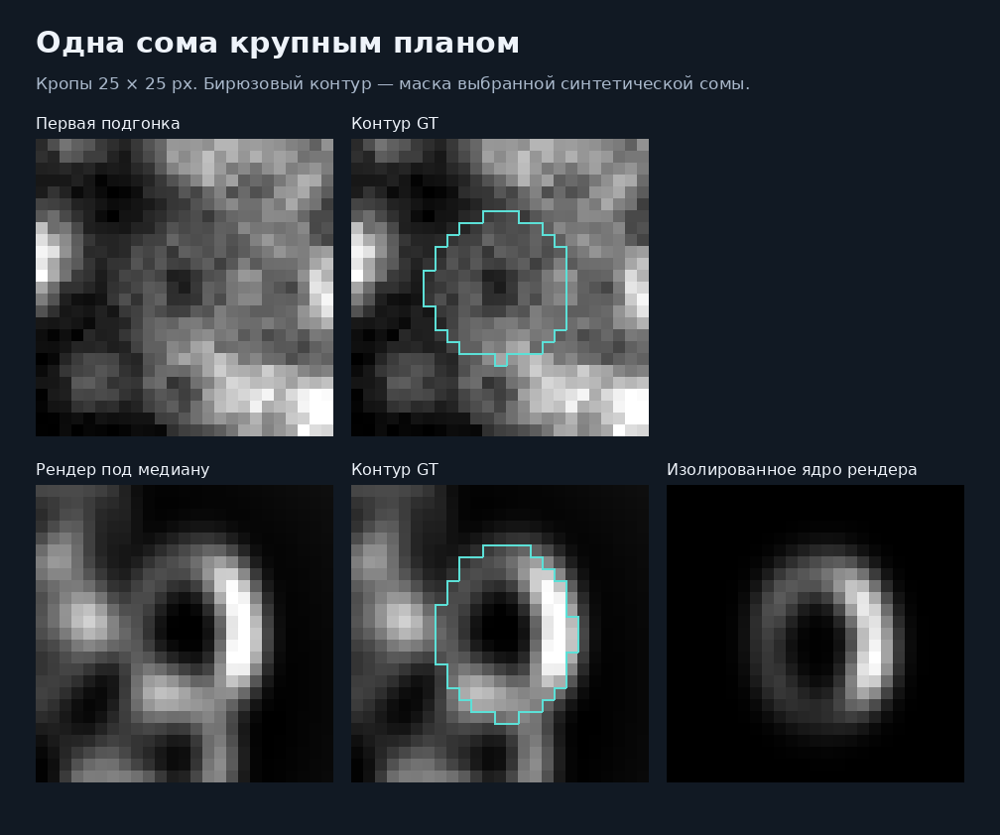

# Как мы делаем синтетику Plane20

Берём реальную запись мозга zebrafish как ориентир и рисуем по ней новые 2D-срезы. Из записи берём общий силуэт ткани, распределение яркости и примеры того, как выглядят сомы. На выходе получаем картинку и отдельную маску каждой нарисованной сомы.

## Что я добавил руками

- **Контуры сом на одиночном кадре.** Обвел 100 сом на восьми кропах кадра №501. В подгонку формы вошли 98 полных контуров. Границу проводили примерно посередине светлой оболочки (изначально), включая тёмный центр в маску. По этим контурам оценили размеры, вытянутость и ориентацию сом. Яркость по обе стороны от контура дала ориентир для профиля оболочки.

- **Участки без сом.** На изображении 90-го перцентиля по фильму отметил с помощью полуавтоматической заливки связных тёмных зон. Объединённая заливка задаёт области, куда не ставим сомы. Для оценки фона используем яркость в этих зонах из среднего по фильму.

- **Контуры и участки на медиане.** Отдельно обвели 20 сом на выровненной медиане по внешнему видимому краю (теперь по краю сомы). Четырнадцать контуров использовали для подгонки света оболочки, шесть оставили для проверки. На выбранных кропах сравнили яркость дуг и фоновую текстуру.

Число сом и некоторые коэффициенты контраста выбирали при сравнении пробных рендеров (глазомер Дамира Саитова). Например, в кадровом режиме квадратичную часть дисперсии шума оставили на уровне четверти от исходной оценки по фильму.

## Как появляется картинка (если вам важно верхнеуровневое устройство это можно скипнуть)

### Откуда берутся центры и размеры

По сглаженному кадру намечаем ткань и исключаем размеченные пустые зоны. Внутри ткани более яркие участки получают больше шансов при выборке центров. Это грубая подсказка по плотности. После случайной выборки центры немного раздвигаем, чтобы убрать кучки и дыры. Сомы, которые целиком не помещаются в разрешённую область, отбрасываем. В режиме под медиану дополнительно прореживаем слишком близкие центры. В обучающем наборе Wide64 получалось около 1 870 сом на сцену, и их контуры могли пересекаться.

Каждый объект — 2D-эллипс, который изображает тело нейрона в оптическом срезе. Диаметр $D$ выбираем из нормального распределения со средним $8.13$ и стандартным отклонением $1.43$ пикселя, оставляя положительные значения. Отношение осей $q$ получаем как $1+\mathrm{Gamma}(2.34,\,0.0984)$, где числа задают форму и масштаб распределения. Для ориентации $\theta$ подгоняем равномерное распределение (по окружности). Размеры полуосей и форму маски задаём так.

$$
a=\frac{D\sqrt q}{2},\qquad b=\frac{D}{2\sqrt q},\qquad
\rho=\sqrt{(u/a)^2+(v/b)^2},\qquad M=\mathbf{1}_{\{\rho\le1\}}.
$$

Здесь $u,v$ — координаты относительно центра сомы вдоль её собственных осей. В режиме под медиану базовый $D$ увеличиваем в $1.524$ раза, а $q$ — в $1.084$ раза по подгонке к новым контурам. При пересечении сом каждая сохраняет свою полную маску $M$.

### Как светится край

Поперёк края яркость спадает по гауссиане. Вдоль края четыре плавных волны делают одни дуги ярче, а другие слабее. Если $s$ — доля пройденного периметра, то свет до размытия задаётся так.

$$
K_i(\rho,s)\propto
\exp\!\left[-\frac{(\rho-\rho_0)^2}{2\sigma_\rho^2}\right]
\exp\!\left[0.5\sum_{k=1}^{4}
\bigl(c_{ik}\cos(2\pi ks)+d_{ik}\sin(2\pi ks)\bigr)\right].
$$

Почему? Я хз это вот чисто кодекс, наверное в этом есть сакральный мсымл

Коэффициенты $c_{ik},d_{ik}$ случайны и свои у каждой сомы. Вклад высоких гармоник слабее. После модуляции сохраняем суммарный свет оболочки, так что волны перераспределяют его между дугами.

| Режим | Где максимум света $\rho_0$ | Ширина профиля $\sigma_\rho$ |
|---|---:|---:|
| Под одиночный кадр | $1.00$, на контуре маски | $0.306$ |
| Под медиану | $0.78$, внутри контура маски | $0.19$ |

Ширина указана в долях эллиптического радиуса. Вдоль большой полуоси она соответствует $a\sigma_\rho$ пикселей до размытия. Центр остаётся темнее края. В нём всё же видны хвосты оболочки, размытие и свет соседей.

### Откуда берутся светлые и тёмные участки

Целую сому умножаем на случайную амплитуду $A_i$. Плавное поле $G$ даёт общую яркость соседям на масштабе около 28 пикселей, а независимая поправка $\epsilon_i$ добавляет разброс между отдельными сомами. Среднюю амплитуду по сцене приводим к единице.

$$
A_i\propto\exp\!\left[0.55\,G(p_i)+0.35\,\epsilon_i\right],
\qquad \epsilon_i\sim\mathcal N(0,1).
$$

Свет всех сом складываем. Сумму дополнительно размываем двумя способами и смешиваем с весом $w(p)=1/(1+\exp[-1.5H(p)])$. Здесь $H$ — отдельное плавное поле фокуса с масштабом около 40 пикселей. Это размытие идёт поверх базового размытия каждой сомы на 0.6 пикселя. Плавная огибающая, оценённая по записи, задаёт итоговый уровень клеточного света на крупных участках. У границ разрешённой области клеточный свет плавно затухает.

---

### Что добавляем к клеточному сигналу

**Под одиночный кадр.** У клеточного сигнала усиливаем перепад относительно его локального среднего с коэффициентом $1.8$ и сохраняем суммарную яркость. Прибавляем плавный фон $B(p)$ и шум. Здесь $p$ — координаты пикселя, $S_{\mathrm{frame}}$ — сигнал сом после поправки контраста, $Z$ — гауссово зерно с единичной дисперсией.

$$
I_{\mathrm{frame}}(p)=B(p)+S_{\mathrm{frame}}(p)+\sigma(p)Z(p).
$$

Зерно смешивает белый шум и сглаженную копию другого белого шума. Поэтому шум соседних пикселей частично совпадает, с корреляцией около $0.265$. Амплитуда $\sigma(p)$ берётся из заранее рассчитанной карты. В неё входит нижний уровень дисперсии и поправка, которая зависит от локальной яркости $F$ опорного рендера и карты временных колебаний $\alpha$ из реального фильма.

$$
\sigma^2(p)=v_0+\alpha(p)\bigl[gF(p)+0.25\,eF(p)^2\bigr].
$$

$F$ — сглаженная яркость выше базового уровня детектора. $v_0$, $g$ и $e$ оценены по разностям соседних кадров. Множитель $\alpha(p)$ переносит наблюдаемую по фильму неоднородность шума и ограничен диапазоном от 0 до 4.

**Под медиану.** Ориентир — реальная попиксельная медиана по 977 выровненным кадрам. Синтетическую картинку рисуем сразу. Для базовой версии из плавной яркости медианы $G_{12}*I_{\mathrm{med}}$ вычитаем плавную часть клеточного сигнала $G_{12}*S$ и получаем фон $B_{\mathrm{med}}$. Так яркость сом учитывается один раз. Здесь $G_\sigma*$ означает гауссово сглаживание с шириной $\sigma$ в пикселях, а $B_{\min}$ — нижний предел фона.

$$
B_{\mathrm{med}}=\max\bigl(B_{\min},\,G_{12}*I_{\mathrm{med}}-G_{12}*S\bigr),
\qquad I_{\mathrm{base}}=B_{\mathrm{med}}+S.
$$

Во втором рендере часть света оболочек переводим в рассеянную засветку. При $f(p)$, доле снятого в данной точке света, снимаем $R(p)=f(p)S(p)$, возвращаем его после размытия на 8 пикселей и добавляем фоновую текстуру $T(p)$.

$$
I_{\mathrm{struct}}=S-R+\max\bigl(B_{\min},\,B_{\mathrm{med}}+G_8*R+T\bigr).
$$

Два поля задают, где снять свет. $m(p)$ плавно растёт внутри случайно выбранных областей ткани, а $h(p)$ равно единице внутри выбранного пересвеченного кропа и плавно спадает за его границами. Оба поля лежат в диапазоне от 0 до 1.

$$
f(p)=1-\bigl(1-0.22\,m(p)\bigr)\bigl(1-0.70\,h(p)\bigr),
\qquad T(p)\propto m(p)\,U(p).
$$

Так случайная область сама по себе ослабляет свет оболочек до 78%, а выбранный кроп — до 30%. Поле текстуры $U$ получаем из шума, сглаженного на 4.2 пикселя, и убираем из него медленные перепады. Силу текстуры подбирали по контрасту реальной медианы. У обоих рендеров одинаковые центры и маски.

## Чем это отличается от SimCalc

- **Свечение вдоль оболочки.** Базовый SimCalc строит кольцо из разности двух гауссиан. На одном эллиптическом радиусе яркость этого кольца одинакова по всему периметру. В Plane20 у каждой сомы свой рисунок светлых и слабых дуг. В SimCalc маска строится по порогу яркости ядра. В Plane20 маску задаёт полный эллипс по модели ручных контуров, поэтому она включает тёмный центр и слабые участки.

- **Яркость соседних сом и резкость.** В базовом SimCalc яркость клетки меняется вместе с её кальциевым сигналом, а плавный пространственный фон рисуется отдельно. В Plane20 общее случайное поле связывает яркость соседних сом, и отдельное поле фокуса меняет степень размытия по кадру. В старой локальной калибровке Fish4 Plane16 уже были карта усиления и одинаковое гауссово размытие. В Plane20 к ним добавились случайные перепады яркости целых групп сом и пространственно меняющееся размытие.

- **Варианты освещения одной сцены.** Старый SimCalc highSNR в этом репозитории уже рисовал статичные кадры с детекторным шумом на деформируемом шаблоне. Под медиану Plane20 для тех же сом и масок рисуем два варианта. Во втором часть света оболочек превращаем в плавную засветку и добавляем местную фоновую текстуру.

## Что за модель сегментации

**Wide64** — обученный сегментатор сом на двух типах синтетики под медиану. Один общий U-Net строит карту центров и две субпиксельные поправки к координатам. Для каждого найденного центра маленькая отдельная голова выдаёт маску в окне 24×24 пикселя. Маски разных сом могут пересекаться.

| | Wide64 |
|---|---|
| Архитектура | U-Net глубины 3, 64 фильтра на первом уровне, 5 504 992 параметра. TensorFlow 2.15.1 / Keras |
| Вход | Одноканальные кропы 128×128, нормализация по P5–P95 каждого кропа, рабочая область 96×96 |
| Данные | 1 024 / 96 / 128 независимых сцен для train / val / test. По два рендера на сцену, в батче поровну кропов каждого стиля |
| Обучение | 100 эпох по 320 шагов, batch 32, до 40 масок на кроп для головы масок. Adam, learning rate 3×10⁻⁴, seed 42 |
| Функция потерь | Focal loss для центров, L1 для поправок координат, взвешенная BCE и soft Dice для масок |
| Синтетический тест | Лучший чекпойнт по val loss — эпоха 97. На 256 тестовых кропах двух стилей F1 масок ≈ 0,995 при IoU ≥ 0,5, средний IoU совпавших масок ≈ 0,950. Пороги центра и маски — 0,3 и 0,5 |

До Wide64 был короткий пилот той же архитектуры с 32 базовыми фильтрами и 1 392 160 параметрами.

## Как менялась синтетика

1. **Начали с NAOMi и SimCalc highSNR.** Потом сохранили отдельную калибровку SimCalc под одиночные кадры Fish4 Plane16.
2. **Перешли на Plane20.** Сначала подогнали синтетику под кадр №501 и попробовали более плотную укладку сом. Добавили инструменты для ручной обводки сом и разметки пустых областей.
3. **Переделали внешний вид клеток.** По обводкам уточнили форму, добавили неравномерное свечение оболочки, плавный фон и шум, похожий на шум одиночного кадра. Для визуальной проверки добавили Crop Quiz.
4. **Перешли на медиану.** Выровняли реальные кадры, заново уточнили размеры сом и их свечение, затем сделали два стиля рендера на одних масках. На этой смеси обучили пилот и Wide64, а для просмотра предсказаний на реальной медиане добавили ROI Lab.
